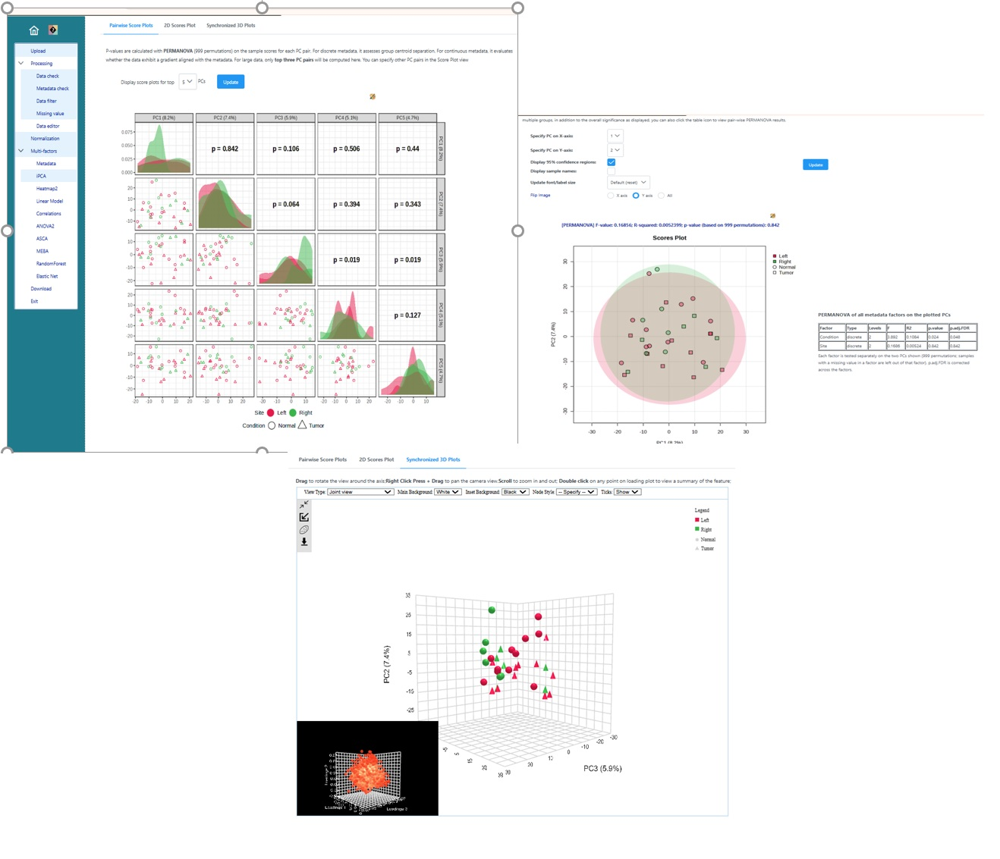
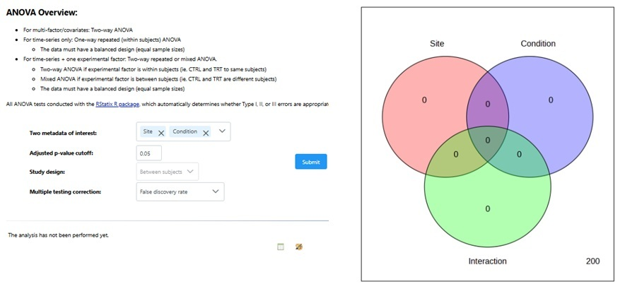
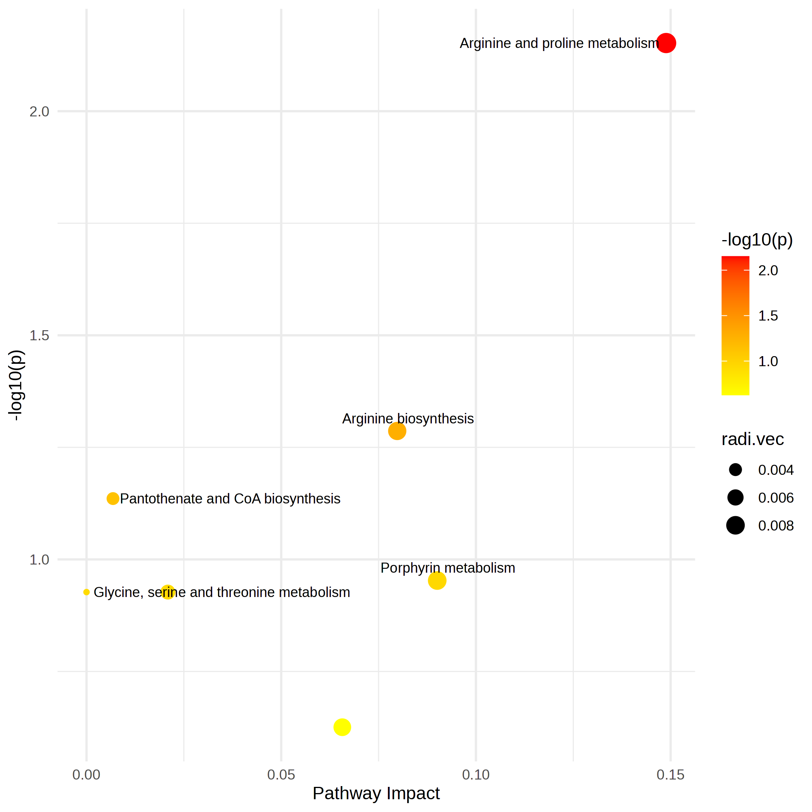
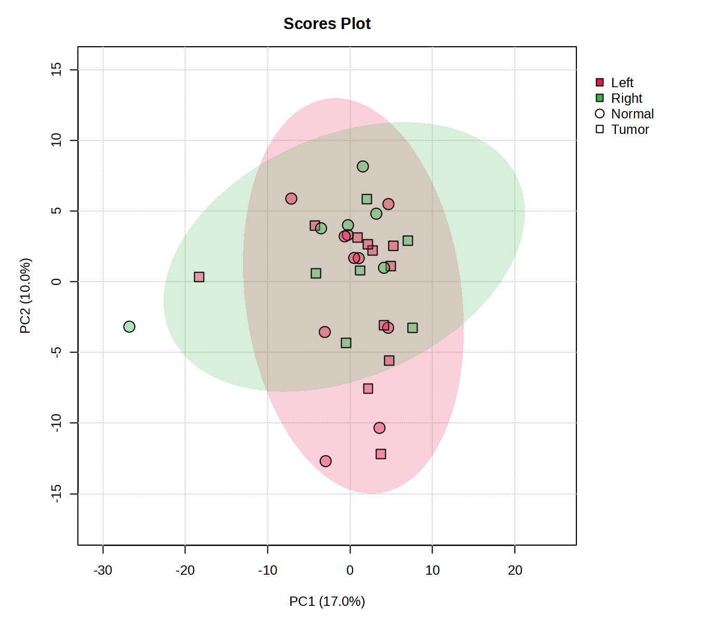
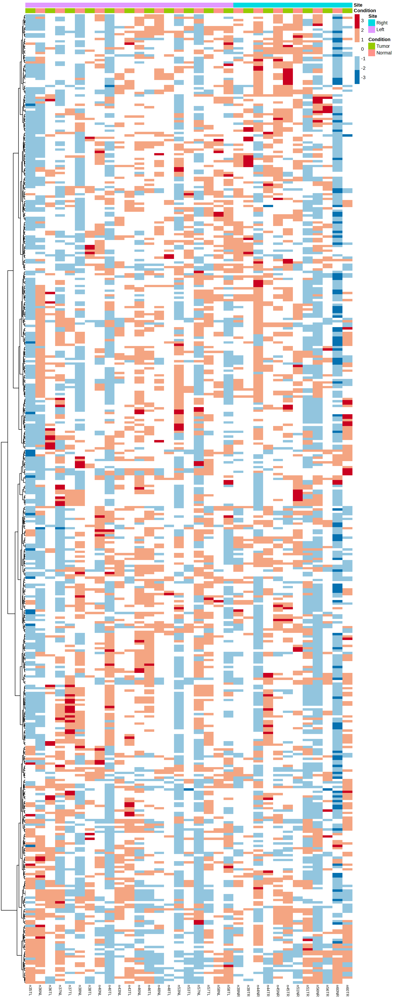

# Caracterización del perfil metabolómico de tejido tumoral y mucosa adyacente en cáncer colorrectal mediante espectrometría de masas LC-MS..

## 1. Descripción del proyecto

Este proyecto tiene como objetivo explorar las diferencias en los perfiles metabólicos del tejido tumoral y la mucosa adyacente de pacientes con cáncer colorrectal, mediante el análisis de datos metabolómicos no dirigidos obtenidos por cromatografía líquida acoplada a espectrometría de masas (LC-MS).

## 2. Dataset

Identificador: ST001087.

Repositorio: Metabolomics Workbench.

Tipo de muestra: tejido tumoral y mucosa adyacente.

Técnica analítica: LC-MS.

Modos de ionización: positivo y negativo.

Número de muestras cuantificadas: 67.

## 3. Herramientas utilizadas

Metabolomics Workbench: obtención de datos y metadatos.

Microsoft Excel: organización, depuración e integración de resultados.

MetaboAnalyst: preprocesamiento, análisis estadístico y multivariado.

KEGG: consulta e interpretación de rutas metabólicas.

FindByFormula: anotación química tentativa.

## 4. Pipeline analítico

Obtención y organización de matrices y metadatos.

Separación de los modos de ionización positivo y negativo.

Filtrado de variables y tratamiento de valores faltantes.

Normalización por suma, transformación logarítmica y escalado Pareto.

Análisis exploratorio mediante PCA.

Evaluación multivariada mediante PERMANOVA.

Análisis diferencial mediante modelos lineales.

Anotación tentativa de metabolitos.

Enriquecimiento de rutas metabólicas.

Integración y priorización de metabolitos candidatos.

## 5. Análisis estadístico y multivariado

Se realizaron análisis exploratorios mediante PCA y pruebas estadísticas para evaluar las diferencias metabólicas entre tejido tumoral y mucosa adyacente, considerando los modos de ionización positivo y negativo.

Se aplicaron modelos lineales ajustados por el sitio anatómico y corrección por pruebas múltiples mediante FDR.

## 6. Resultados principales

Los análisis exploratorios mostraron diferencias en los perfiles metabólicos entre las condiciones evaluadas. Sin embargo, ningún metabolito individual alcanzó significancia estadística después de la corrección por pruebas múltiples (FDR < 0.05).

En el modo positivo se identificaron señales exploratorias de interés, mientras que en el modo negativo no se obtuvieron metabolitos diferencialmente significativos después del ajuste estadístico.

## 7. Priorización de metabolitos candidatos

Se priorizaron señales con interés biológico potencial, entre ellas:

5'-Methylthioadenosine (MTA).

AMP.

Creatina.

N²,N²-Dimethylguanosine.

Acetyl-maltose.

Estas anotaciones son tentativas y requieren validación mediante espectrometría de masas en tándem (MS/MS) y estándares de referencia.

## 8. Enriquecimiento funcional

El análisis de enriquecimiento en modo positivo permitió explorar rutas metabólicas potencialmente relacionadas con los cambios observados. Ninguna ruta alcanzó significancia estadística después de la corrección por pruebas múltiples.

## 9. Conclusión

El estudio permitió caracterizar exploratoriamente los perfiles metabólicos del tejido tumoral y la mucosa adyacente en cáncer colorrectal, e identificar señales candidatas para futuras investigaciones. Los resultados constituyen una base para generar hipótesis sobre posibles alteraciones metabólicas, pero requieren validación adicional antes de establecer biomarcadores o rutas metabólicas confirmadas.

## 10. Figuras de los resultados

### 10.1. Modo de ionización positivo

**Análisis de componentes principales (PCA)**

**Análisis estadístico (ANOVA)**

**Enriquecimiento de rutas metabólicas**

### 10.2. Modo de ionización negativo

**Análisis de componentes principales (PCA)**

**Mapa de calor**

